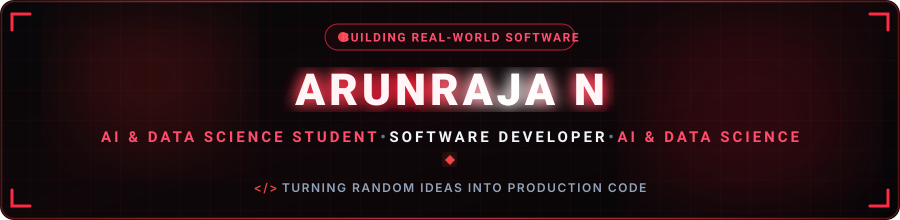
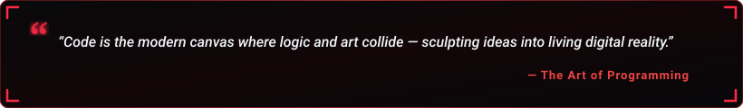

  

  

  
  &nbsp;
  
  &nbsp;
  

  

---

<h2 align="center">🔴 About Me</h2>

  

  

  Hey! I'm <b>Arunraja N</b>, a <b>B.Tech Artificial Intelligence &amp; Data Science student</b> at <b>Ramco Institute of Technology</b>, India. I enjoy building practical software with Python, FastAPI, React and databases, and exploring how AI and intelligent document processing can solve real-world problems.

  
  &nbsp;
  
  &nbsp;
  

  💬 <b>Interested in:</b> Python, FastAPI, React, REST APIs, SQL, AI/ML and intelligent automation. 
  ⚡ <b>Philosophy:</b> <i>Learn the fundamentals, build consistently, and turn ideas into useful products.</i>

<table width="100%" border="0" align="center">
<tr>
<td width="50%" align="center" style="padding: 14px;">
  <h4>🔭 Featured Project</h4>
  
<a href="https://github.com/arunraja124-stack/Smartledger" target="_blank"><b>SmartLedger</b></a> AI-Powered Digital Register Management &amp; Intelligent Document Processing

</td>
<td width="50%" align="center" style="padding: 14px;">
  <h4>🌱 Currently Exploring</h4>
  
<b>AI &amp; Backend Engineering</b> FastAPI, React and reliable database design

</td>
</tr>
<tr>
<td width="50%" align="center" style="padding: 14px;">
  <h4>🎓 Education</h4>
  
<b>Ramco Institute of Technology</b> B.Tech – Artificial Intelligence &amp; Data Science

</td>
<td width="50%" align="center" style="padding: 14px;">
  <h4>🤝 Collaboration</h4>
  
<b>AI &amp; Software Projects</b> Open to learning and building together

</td>
</tr>
</table>

---

<h2 align="center">🔴 Featured Project Spotlight</h2>

<table width="100%" border="0" align="center">
<tr>
<td align="center" style="padding: 22px;">
  <h3>📒 SmartLedger</h3>
  
<i>An AI-powered digital register management and intelligent document processing system. The project combines a React frontend with a FastAPI backend and MySQL database, with OCR-based document processing capabilities.</i>

   
  

    
  

  
Stack: Python · FastAPI · React · Vite · Tailwind CSS · MySQL · SQLAlchemy · Tesseract OCR · OpenCV

</td>
</tr>
</table>

---

<h2 align="center">🛠️ Tech Stack &amp; Skills</h2>

<b>Programming Languages</b>

  

<b>Frontend &amp; Backend Development</b>

  

<b>Databases, AI &amp; Developer Tools</b>

  

  
  &nbsp;
  
  &nbsp;
  
  &nbsp;
  

---

<h2 align="center">📊 GitHub Analytics &amp; Activity</h2>

  
  &nbsp;&nbsp;
  

  

  

---

<h2 align="center">⚡ Contribution Journey</h2>

  

---

<h2 align="center">📬 Let's Connect &amp; Collaborate</h2>

<i>Interested in AI, backend development, intelligent automation or building useful software? Feel free to connect!</i>

<table border="0" align="center">
<tr>
<td align="center" width="220" style="padding: 16px;">
  <a href="https://www.linkedin.com/in/arunraja-n-54aa1422/" target="_blank">
    
      
    
  </a>
   
  <b>Professional Network</b>
</td>
<td align="center" width="220" style="padding: 16px;">
  <a href="mailto:arunrajakrishnan12@gmail.com">
    
      
    
  </a>
   
  <b>Direct Collaboration</b>
</td>
<td align="center" width="220" style="padding: 16px;">
  <a href="https://github.com/arunraja124-stack" target="_blank">
    
      
    
  </a>
   
  <b>Projects &amp; Code</b>
</td>
</tr>
</table>

  

